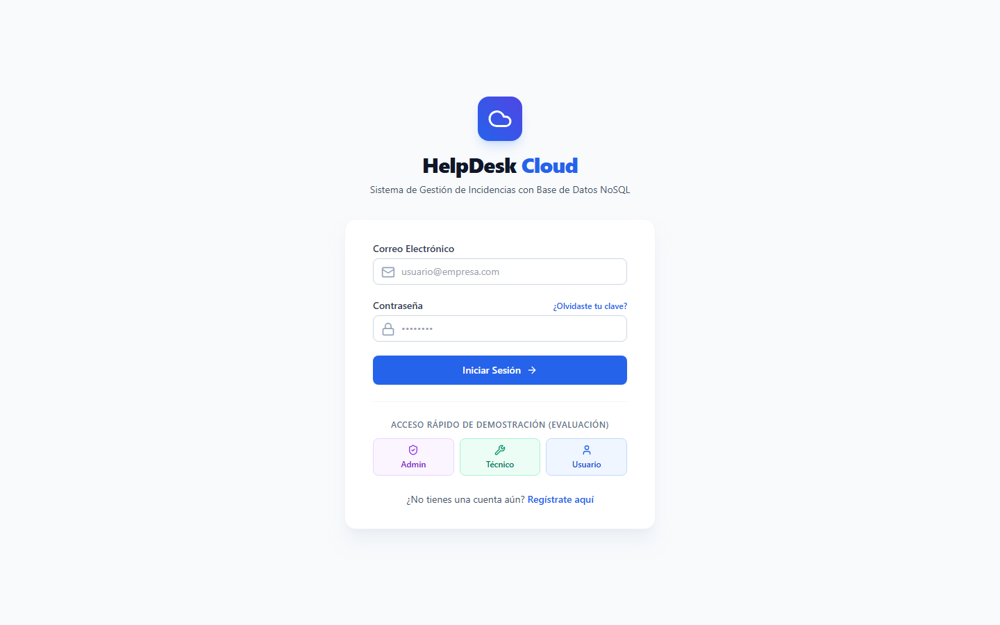
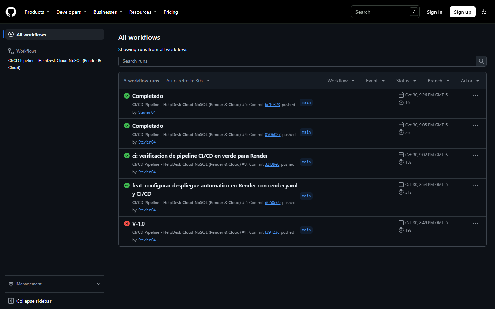

# Estrategia de respaldo en bases de datos NoSQL: construcción y despliegue automatizado de HelpDesk Cloud con Cloud Firestore y CI/CD

**Autor:** Stevie Marca Aguilar
**Fecha:** noviembre de 2026
**Etiquetas:** nosql, firebase, devops, githubactions

---

## 1. Problema y objetivo

Las bases de datos NoSQL en la nube son hoy una opción habitual cuando una aplicación necesita esquemas flexibles, baja latencia y alta concurrencia. Pero hay una pregunta que suele quedar para el final: **¿cómo se respalda y se recupera una base de datos que no tiene tablas, que guarda documentos anidados y que vive repartida entre varios centros de datos?**

Para responderla con un caso práctico construimos **HelpDesk Cloud**, una aplicación web de gestión de incidencias de soporte técnico. El objetivo del proyecto fue triple:

1. Desarrollar una aplicación funcional sobre una base de datos NoSQL documental.
2. Publicarla en la nube mediante un flujo de integración y despliegue continuo (CI/CD).
3. Diseñar una estrategia de respaldo y recuperación ante desastres adecuada a un motor NoSQL.

Este artículo recorre la arquitectura, el modelo de datos, las funcionalidades, el pipeline de CI/CD y, sobre todo, la estrategia de respaldo.

**Enlaces del proyecto**

- Repositorio público: [github.com/Stevien04/HelpDesk-Cloud](https://github.com/Stevien04/HelpDesk-Cloud)
- Aplicación desplegada: [helpdesk-cloud.onrender.com](https://helpdesk-cloud.onrender.com)
- Video demostrativo (menos de 5 minutos): [youtube.com/watch?v=ChbUKJrGsBg](https://www.youtube.com/watch?v=ChbUKJrGsBg)

---

## 2. Por qué NoSQL y por qué Cloud Firestore

**Cloud Firestore** es una base de datos NoSQL de tipo documental: no almacena filas en tablas, sino documentos (objetos con pares campo-valor) agrupados en colecciones. No exige un esquema fijo, y un documento puede contener sus propias subcolecciones.

Ese modelo encaja bien con una mesa de ayuda por tres razones:

1. **Atributos variables.** Una incidencia de hardware no necesita los mismos datos que una de software o de red. En un modelo relacional eso obliga a columnas vacías o a tablas adicionales; en un documento, cada ticket lleva solo los campos que usa.
2. **Jerarquía natural.** Cada ticket tiene un historial cronológico de intervenciones. En Firestore ese historial es una subcolección del propio ticket, sin tablas intermedias ni JOIN.
3. **Seguridad en el motor de datos.** La aplicación no tiene servidor propio. Son las reglas de seguridad de Firestore las que validan, en cada lectura y escritura, la identidad del usuario y su rol.

Además, Firestore es un servicio gestionado: escala solo y no requiere administrar servidores.

---

## 3. Arquitectura y modelo de documentos

La solución tiene tres capas:

```text
+----------------------------------------------------------------+
|  PRESENTACIÓN                                                  |
|  React 19 + Vite + Tailwind CSS (SPA)                          |
|  Publicada en Render como sitio estático (CDN + HTTPS)         |
+----------------------------------------------------------------+
                         | Firebase Web SDK (HTTPS)
                         v
+----------------------------------------------------------------+
|  SERVICIOS EN LA NUBE                                          |
|  Firebase Authentication      |   Cloud Firestore (NoSQL)      |
|  correo y contraseña, JWT     |   documentos + reglas          |
+----------------------------------------------------------------+
                         ^
                         | gcloud / tarea programada
+----------------------------------------------------------------+
|  RESPALDO Y RESILIENCIA                                        |
|  Point-in-Time Recovery       |   Exportaciones a Cloud Storage|
+----------------------------------------------------------------+
```

El modelo de datos usa dos colecciones principales y una subcolección:

```text
usuarios/{uid}
   nombre, email, rol ('usuario' | 'tecnico' | 'admin'), activo, fechaCreacion

tickets/{ticketId}
   titulo, descripcion, categoriaId, prioridad, estado,
   creadoPor, creadorNombre, asignadoA, asignadoNombre,
   fechaCreacion, fechaActualizacion
   │
   └── historial/{eventoId}
          tipo, autorId, autorNombre, anterior, nuevo, comentario, fecha
```

Dos decisiones de diseño merecen comentario:

- **Desnormalización.** El ticket guarda `creadorNombre` y `asignadoNombre` además de los identificadores. Así la lista de tickets se muestra con una sola consulta, sin leer la colección `usuarios` por cada fila.
- **Escrituras atómicas.** Crear un ticket, asignarlo o cambiar su estado modifica el ticket y agrega un evento al historial dentro de un mismo `writeBatch`. O se guardan los dos cambios o no se guarda ninguno, de modo que el historial nunca queda desfasado respecto del ticket.

```js
const batch = writeBatch(db);
batch.update(ticketRef, { estado: newStatus, fechaActualizacion: serverTimestamp() });
batch.set(doc(collection(ticketRef, 'historial')), {
  tipo: 'cambio_estado',
  autorId: user.uid,
  anterior: currentStatus,
  nuevo: newStatus,
  fecha: serverTimestamp()
});
await batch.commit();
```

Las reglas de seguridad (`firestore.rules`) completan el modelo:

| Operación | Usuario | Técnico | Administrador |
|---|---|---|---|
| Crear su perfil | Solo con rol `usuario` | — | Sí |
| Cambiar roles | No | No | Sí |
| Ver tickets | Solo los propios | Solo los asignados | Todos |
| Asignar técnico | No | No | Sí |
| Modificar o borrar historial | No | No | No |

El historial es inmutable para todos los roles, incluido el administrador:

```js
match /historial/{eventoId} {
  allow update, delete: if false;
}
```

---

## 4. Funcionalidades desarrolladas

La aplicación distingue tres roles:

- **Usuario:** se registra, crea tickets (título, descripción, categoría y prioridad), sigue su estado y agrega comentarios.
- **Técnico:** ve los tickets que tiene asignados, los pasa a «En proceso» y a «Resuelto», y documenta la solución.
- **Administrador:** ve todos los tickets, los asigna a técnicos, gestiona roles y consulta reportes.

Un ticket recorre los estados `pendiente → en_proceso → resuelto → cerrado`. Las transiciones permitidas dependen del rol: por ejemplo, el técnico puede pasar un ticket de pendiente a en proceso, y el usuario que lo creó lo cierra una vez resuelto; el administrador puede hacer cualquier cambio. Esa lógica está en `src/utils/validators.js` y tiene sus propias pruebas unitarias.

La pantalla de inicio incluye accesos rápidos de demostración para cada rol. Cada uno inicia sesión con una cuenta de demostración real, de modo que los tres roles leen y escriben los mismos datos en Firestore y cualquiera puede recorrer el flujo completo sin registrarse:



El módulo de reportes incorpora además un panel con la estrategia de respaldo: niveles, objetivos de recuperación y comandos.

---

## 5. Repositorio público y organización del código

El código es público en [github.com/Stevien04/HelpDesk-Cloud](https://github.com/Stevien04/HelpDesk-Cloud) y está organizado así:

```text
HelpDesk-Cloud/
├── .github/workflows/deploy.yml   # Pipeline de CI/CD
├── docs/                          # Arquitectura, modelo, respaldo y despliegue
├── scripts/firestore-backup.js    # Automatización de la exportación
├── src/
│   ├── components/                # Navbar, Sidebar, TicketCard, TicketForm…
│   ├── context/                   # AuthContext (sesión y rol)
│   ├── hooks/                     # useAuth, useTickets
│   ├── pages/                     # Login, Dashboard, Tickets, Reportes…
│   ├── services/                  # Acceso a Firebase Auth y Firestore
│   └── utils/                     # Validaciones y transiciones de estado
├── tests/                         # Pruebas unitarias (Vitest)
├── firestore.rules                # Reglas de seguridad
├── firestore.indexes.json         # Índices compuestos
└── render.yaml                    # Infraestructura del despliegue
```

Las credenciales de Firebase no están en el repositorio: se leen de variables de entorno (`.env` en local, secretos en GitHub y en Render). El archivo `.env.example` documenta cuáles hacen falta.

---

## 6. Estrategia de respaldo NoSQL

Respaldar Firestore no se parece a ejecutar `pg_dump` o `mysqldump` sobre un servidor. Los datos están particionados y replicados entre nodos, la aplicación sigue escribiendo mientras se copia, y hay que conservar la jerarquía de documentos y subcolecciones. Por eso la estrategia combina dos niveles con propósitos distintos.

```text
                    CLOUD FIRESTORE (producción)
                 usuarios · tickets · historial
                     |                    |
        Nivel 1: continuo        Nivel 2: programado
                     v                    v
       Point-in-Time Recovery     Cloud Scheduler (02:00 UTC)
       7 días de retención                |
       recuperación al segundo            v
                                  Exportación a Cloud Storage
                                  Standard → Nearline → Coldline
```

### Nivel 1: Point-in-Time Recovery (PITR)

PITR conserva las versiones anteriores de los documentos durante 7 días y permite leer o restaurar la base tal como estaba en un instante concreto. Es la defensa contra el error más frecuente: un borrado o una actualización masiva equivocada.

```bash
# Activar PITR
gcloud firestore databases update --database="(default)" \
  --point-in-time-recovery=ENABLE

# Recuperar el estado de un instante concreto en una base nueva
gcloud firestore databases clone \
  --source-database="(default)" \
  --destination-database="helpdesk-restored" \
  --point-in-time="2026-10-30T20:00:00Z"
```

### Nivel 2: exportaciones programadas a Cloud Storage

PITR solo cubre una semana. Para conservar copias históricas se programa una exportación diaria a un bucket de Cloud Storage, con reglas de ciclo de vida que mueven las copias antiguas a clases de almacenamiento más baratas (Standard los primeros 30 días, luego Nearline y Coldline).

```bash
gcloud firestore export gs://helpdesk-cloud-backups/$(date +%Y%m%d_%H%M%S) \
  --collection-ids='tickets','usuarios','categorias','historial'
```

Un detalle propio de NoSQL: `--collection-ids` filtra por identificador de colección, y las subcolecciones no se incluyen por pertenecer a un documento exportado. Si se omite `historial`, la copia contiene los tickets pero no su auditoría.

El repositorio incluye el script `scripts/firestore-backup.js`, que arma y ejecuta este comando con la marca de tiempo del momento:

```bash
node scripts/firestore-backup.js --bucket=gs://helpdesk-cloud-backups
```

### Objetivos de recuperación

| Métrica | Significado | Objetivo | Mecanismo |
|---|---|---|---|
| **RPO** | Cuántos datos se pueden perder, medido en tiempo | Menos de 1 minuto | PITR |
| **RTO** | Cuánto se tarda en restaurar el servicio | Menos de 20 minutos | Clonado o `gcloud firestore import` |

### Prueba de restauración

Un respaldo que nunca se ha restaurado no es un respaldo fiable. El procedimiento de prueba previsto es:

```bash
# 1. Comprobar que la exportación existe
gsutil ls -l gs://helpdesk-cloud-backups/20261030_020000/

# 2. Importarla en una base de datos de pruebas, nunca sobre producción
gcloud firestore import gs://helpdesk-cloud-backups/20261030_020000/ \
  --database="helpdesk-dr-test"
```

Después se valida que el número de tickets coincide con producción y que cada historial sigue colgando de su ticket.

### Seguridad de las copias

- Los objetos exportados se cifran en reposo (AES-256) y viajan cifrados entre Firestore y Cloud Storage.
- Solo una cuenta de servicio con el rol `roles/datastore.importExportAdmin` puede lanzar exportaciones, siguiendo el principio de menor privilegio.

---

## 7. Flujo CI/CD con GitHub Actions

El pipeline está en `.github/workflows/deploy.yml` y se ejecuta en cada `push` y en cada pull request hacia `main`:

```yaml
name: CI/CD Pipeline - HelpDesk Cloud NoSQL (Render & Cloud)

on:
  push:
    branches: [main]
  pull_request:
    branches: [main]

jobs:
  test_and_build:
    runs-on: ubuntu-latest
    steps:
      - uses: actions/checkout@v4

      - uses: actions/setup-node@v4
        with:
          node-version: 22
          cache: 'npm'

      - run: npm ci
      - run: npm run test

      - run: npm run build
        env:
          VITE_FIREBASE_API_KEY: ${{ secrets.VITE_FIREBASE_API_KEY }}
          VITE_FIREBASE_PROJECT_ID: ${{ secrets.VITE_FIREBASE_PROJECT_ID }}
          # ...resto de variables de Firebase

      - name: Desplegar a Render
        if: github.ref == 'refs/heads/main' && github.event_name == 'push'
        env:
          RENDER_DEPLOY_HOOK_URL: ${{ secrets.RENDER_DEPLOY_HOOK_URL }}
        run: |
          if [ -n "$RENDER_DEPLOY_HOOK_URL" ]; then
            curl -s -X POST "$RENDER_DEPLOY_HOOK_URL"
          fi
```

El orden importa: si una prueba falla, el flujo se detiene y no se llega a compilar ni a desplegar. El despliegue solo ocurre con un `push` a `main`, no con un pull request.



---

## 8. Publicación en la nube

La aplicación se publica en **Render** como sitio estático. La configuración está versionada en `render.yaml`:

```yaml
services:
  - type: web
    name: helpdesk-cloud
    runtime: static
    buildCommand: npm run build
    staticPublishPath: ./dist
    routes:
      - type: rewrite
        source: /*
        destination: /index.html
```

La regla de reescritura es necesaria en una aplicación de una sola página: sin ella, recargar una ruta como `/tickets` devolvería un error 404, porque ese archivo no existe en el servidor.

La aplicación está disponible con HTTPS en [helpdesk-cloud.onrender.com](https://helpdesk-cloud.onrender.com).

---

## 9. Pruebas, dificultades y resultados

**Pruebas.** El proyecto tiene 13 pruebas unitarias con Vitest, repartidas en dos archivos:

- `tests/validators.test.js`: validación de correo y contraseña, validación del formulario de tickets y transiciones de estado permitidas para cada rol.
- `tests/backup-strategy.test.js`: parámetros de la estrategia de respaldo (retención de PITR, RPO, RTO y colecciones incluidas).

**Dificultades.**

- *Las reglas rechazaban la creación de tickets.* Fue el error más instructivo del proyecto. Crear un ticket escribe dos documentos en un mismo lote: el ticket y su primer evento de historial. La regla del historial comprobaba quién era el dueño del ticket con `get()`, que consulta el estado de la base **antes** del lote, cuando el ticket todavía no existe. Resultado: `Missing or insufficient permissions` para cualquier usuario que no fuera administrador. La solución fue usar `getAfter()`, que evalúa el documento tal como quedará al terminar el lote (regla simplificada):

  ```js
  allow create: if request.resource.data.autorId == request.auth.uid
    && getAfter(/databases/$(database)/documents/tickets/$(ticketId)).data.creadoPor == request.auth.uid;
  ```

- *Un mensaje de éxito que ocultaba el fallo.* El error anterior tardó en aparecer porque la interfaz mostraba una confirmación aunque Firestore hubiera rechazado la escritura. La lección: ante un fallo de guardado, la aplicación debe mostrar el error real, no simular que todo salió bien.
- *La primera ejecución del pipeline falló.* La primera ejecución terminó en error y las siguientes en verde. Tener el pipeline desde el primer commit hizo visible el fallo de inmediato, en lugar de descubrirlo con la aplicación ya publicada.
- *La versión de Node.js importa.* Las versiones actuales de Vite y Vitest no arrancan con Node 20.11; el pipeline fija Node 22 para que el entorno de integración sea siempre el mismo, con independencia de lo que tenga instalado cada integrante.
- *Rutas de una SPA en un hosting estático.* Hubo que añadir la regla de reescritura descrita en el apartado anterior.
- *Subcolecciones y exportaciones.* Como se explicó, el historial debe indicarse de forma explícita al exportar.

**Resultados.**

- Aplicación en producción, accesible públicamente y con tres roles operativos.
- Pipeline de CI/CD funcionando: cada cambio en `main` se prueba, se compila y se publica sin pasos manuales.
- Estrategia de respaldo de dos niveles documentada, con comandos de activación, exportación y restauración, y objetivos de RPO y RTO definidos.

---

## 10. Conclusiones

1. **Firestore acelera el desarrollo, pero traslada la seguridad a las reglas.** Sin un servidor intermedio, las reglas son la única barrera entre el navegador y los datos, y hay que diseñarlas con el mismo cuidado que el modelo.
2. **El modelo documental simplifica la auditoría.** Guardar el historial como subcolección y escribirlo en el mismo lote que el cambio mantiene la trazabilidad sin lógica adicional.
3. **El respaldo en NoSQL se diseña, no se improvisa.** PITR cubre el error reciente con precisión de segundos; las exportaciones cubren la retención a largo plazo. Ninguno de los dos basta por sí solo.
4. **CI/CD convierte el despliegue en rutina.** Con pruebas automáticas antes de cada publicación, llevar un cambio a producción deja de ser un momento de riesgo.

**Enlaces**

- Repositorio: [github.com/Stevien04/HelpDesk-Cloud](https://github.com/Stevien04/HelpDesk-Cloud)
- Aplicación: [helpdesk-cloud.onrender.com](https://helpdesk-cloud.onrender.com)
- Video: [youtube.com/watch?v=ChbUKJrGsBg](https://www.youtube.com/watch?v=ChbUKJrGsBg)

¿Qué estrategia de respaldo usas en tus bases de datos NoSQL? Te leo en los comentarios.
